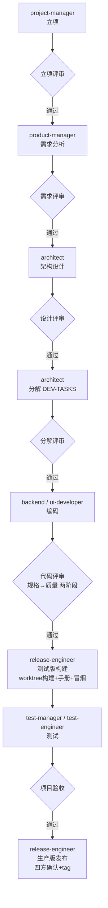

# virtual-team — 虚拟软件开发团队插件

按 `statement.txt` 描述的软件开发团队与流程，为 CodeBuddy / WorkBuddy 构建的可编排插件：**12 个角色 agent + 23 个技能 skill + 11 个工作流命令 + 31 个交付物模版**，覆盖 立项 → 需求 → 设计 → 编码 → 评审 → 测试 → 验收 → 发布 全流程。

插件在设计上遵循业界成熟实践：**证据先于结论**（验证后才声称完成）、**两阶段代码评审**（先规格符合性、后代码质量）、**完成状态协议**（DONE/BLOCKED 等必报）、**决策简报格式**（提问结构化）、**用户主权**（模型建议、用户决定）、**评审闭环**、**最简代码 / YAGNI**、**反合理化红线**。规则集中在 `rules/`，所有角色开工前必读。

## 目录结构

```
virtual-team-plugin/
├── .codebuddy-plugin/
│   ├── plugin.json                    # 插件清单
│   └── marketplace.json               # 单插件自市场（可作为本地 marketplace 安装）
├── rules/
│   ├── team-charter.md                # 团队公约：角色纪律、编号规范、目录结构、评审闭环
│   ├── engineering-discipline.md      # 工程纪律：证据先于结论、两阶段评审、完成状态协议、YAGNI、版本控制
│   ├── decision-brief.md              # 决策简报格式：向用户提问的统一结构（轻量/完整两档）
│   └── storage-track.md               # 存储轨道规则：json/sqlite 双轨唯一规则源（按需加载所选轨道）
├── agents/                            # 12 个角色
│   ├── project-manager.md     product-manager.md   architect.md
│   ├── backend-developer.md   ui-developer.md      code-reviewer.md
│   ├── test-manager.md        test-engineer.md     release-engineer.md
│   └── requirement-reviewer.md design-reviewer.md  project-reviewer.md
├── skills/                            # 23 个技能
│   ├── planning / business-analysis / requirement / requirement-review
│   ├── architecting / data-modelling / general-design / task-breakdown / design-review / datamodel-review
│   ├── code-review
│   ├── case-design / case-instantiate / case-running / case-structure / req-structure
│   ├── test-data-gen / test-rebuild
│   ├── diagramming / doc-writing / accepting / prototype / releasing
├── commands/                          # 11 个工作流入口
├── templates/                         # 31 个交付物模版
├── pages/prototype/                   # 界面原型存放（运行时产出）
├── board/                             # 进度看板存放（运行时产出）
├── docs/ design/ src/ review/ test/ release/   # 各阶段交付目录约定
└── build/                             # 临时/中间文件（禁止污染交付目录）
```

## 角色与流程



> 分解评审**并入设计评审**（同一门禁）；设计评审通过后由架构师产出 `design/DEV-TASKS.md`，再行分解评审。**测试版构建是测试准入条件**：代码评审闭环后由 release-engineer 产出（构建产物+安装手册+冒烟验证），测试环境与 RUN.envs 证据一律来自该构建。用例/TD 设计可与编码并行。

| 阶段 | 角色 | 技能 |
|------|------|------|
| 立项 | project-manager | planning |
| 需求分析 | product-manager | business-analysis, requirement, prototype, req-structure, diagramming |
| 架构设计 | architect | architecting, data-modelling, general-design |
| 任务分解 | architect | task-breakdown |
| 编码 | backend-developer / ui-developer | — |
| 代码评审 | code-reviewer | code-review |
| 测试版构建 | release-engineer | releasing, doc-writing |
| 测试 | test-manager / test-engineer | case-design, case-instantiate, case-running, case-structure |
| 验收 / 生产版发布 | project-reviewer / release-engineer | accepting, releasing, doc-writing |

## 命令

| 命令 | 说明 |
|------|------|
| `/start` | 启动团队，从立项推进完整流程 |
| `/kickoff` | 立项，产出立项报告 |
| `/requirements` | 需求分析 |
| `/design` | 架构设计 |
| `/coding` | 编码（按模块） |
| `/code-review` | 代码评审（两阶段） |
| `/test` | 测试（前置：测试版构建） |
| `/release` | 生产版发布（验收通过后：四方确认 + tag） |
| `/accept` | 项目验收 |
| `/status` | 更新并展示进度看板 |
| `/review` | 通用评审入口（需求/设计/数据模型） |

## 技能触发索引

> 本插件不使用 `triggers` 字段（CodeBuddy 技能 frontmatter 只认 `name`/`description`），触发词写在每个技能的 `description` 里。下表是人工索引，便于检索"什么场景该用哪个技能"。

| 场景 / 触发词 | 技能 | 负责角色 |
|--------------|------|---------|
| 新项目立项、项目定位、范围/约束/里程碑 | `planning` | project-manager |
| 业务建模、角色权限、业务流程、实体状态机、模块划分 | `business-analysis` | product-manager |
| 功能点定义、规格说明书、非功能需求、数据字典、需求追溯 | `requirement` | product-manager |
| 需求评审、需求质量检查 | `requirement-review` | requirement-reviewer |
| 界面原型、线框图、交互草图 | `prototype` | product-manager |
| 功能点结构化、需求追踪清单 | `req-structure` | product-manager |
| 架构设计、技术选型、组件划分、部署视图 | `architecting` | architect |
| 数据库设计、ER 图、DDL、索引 | `data-modelling` | architect |
| 模块/功能设计、接口契约、算法设计、日志设计 | `general-design` | architect |
| 开发任务分解、按模块切分任务、依赖与并行组 | `task-breakdown` | architect |
| 设计评审、架构评审、任务分解评审 | `design-review` | design-reviewer |
| 数据模型专项评审、表结构/DDL 评审 | `datamodel-review` | design-reviewer |
| 代码评审、规格符合性 + 代码质量两阶段 | `code-review` | code-reviewer |
| 测试方案、测试用例（CASE-<组件>-NNN）设计 | `case-design` | test-manager / test-engineer |
| 执行测试、跑用例、缺陷跟踪、测试报告 | `case-running` | test-engineer |
| 建 RUN、用例×数据配对成可执行实例、交审定 | `case-instantiate` | test-engineer |
| 用例结构化、覆盖率矩阵 | `case-structure` | test-engineer |
| 画图（架构图/ER/流程/时序/状态/甘特），统一 Mermaid | `diagramming` | 全体 |
| 安装/发布/用户手册、配置说明 | `doc-writing` | release-engineer |
| 项目验收、立项评审（总体评估） | `accepting` | project-reviewer |
| 构建发布组件、打包部署、标记测试版/生产版 | `releasing` | release-engineer |

## 核心规范

**团队公约**（`rules/team-charter.md`）

- **编号**：组件 `$COMPONENT` ⊃ 模块 `$MODULE`（均 snake_case）。业务 `biz-<组件>-<模块>-NNN`、功能点 `fr-<组件>-<模块>-NNN`（固定 4 段，无模块用 `all`）、用例 `CASE-<组件>-NNN`、数据单元 `TD-<组件>-NNN`、变更 `CR-<组件>-NNN`、缺陷 `BUG-<组件>-NNN`；执行轮 `RUN-NNN`（test-manager 创建）；实例计划行 `P-xxx`（全局唯一）；执行明细 `{plan_ref}-{seq}`（如 `P-003-1`，重跑序号递增——零撞号）。
- **纪律**：职责边界、文件化输入输出、禁止猜测、目录纯净、**任务五步流程**（计划→用户确认→批准后实施→校验→完成报告，微任务可合并确认批准）、交付物须评审、图形用 Mermaid。
- **门禁**：无 P0/P1 不得进入下一阶段；测试需覆盖全部功能点。
- **发布**：四方（产品经理/测试经理/架构师/代码评审员）联合确认方可为生产版并打 tag。

**工程纪律**（`rules/engineering-discipline.md`）

- **证据先于结论**：没有本次验证证据，不得声称"完成/通过/修好"。
- **两阶段评审**：先规格符合性（功能编号全覆盖、无多做漏做），后代码质量。
- **完成状态协议**：收尾必报 `DONE` / `DONE_WITH_CONCERNS` / `BLOCKED` / `NEEDS_CONTEXT`；3 次失败必上报。
- **否定性断言需证据**："做不到/不可能"也要给原文错误或实测；便宜探针先跑再问。
- **混淆协议**：高风险歧义 STOP，给 2–3 选项 + 权衡。
- **用户主权**：模型给建议、用户做决定；不擅自改既定方向。
- **接收评审**：先验证、先澄清，再动手；禁止表演式附和。
- **最简代码 / YAGNI**：不做需求外的抽象与扩展点。
- **反合理化**：常见借口（"太简单不用测""我手动测过了"）已显式封堵。

**决策简报**（`rules/decision-brief.md`）

- 向用户提问/确认统一用 `D<N>` 简报，**两档**：轻量档（单事实澄清，一句直问）与完整档（ELI10 + 建议 + 完整性评分 + ✅❌ 选项优缺点 + `Net`）；不可逆操作永远走完整档。
- 工具不可用时 prose 降级；**不可逆/破坏性操作必须显式确认**，含糊回复视为未确认。

**存储轨道**（`rules/storage-track.md`）

- 测试数据双轨（json / sqlite）**唯一规则源**：立项时一次性选定（`test/STORE-CONFIG.json`），技能开工**只加载所选轨道一节的规则**（不整读）；仅允许一次 json→sqlite 单向迁移。

## 安装

### 方式一：作为本地 marketplace 安装（推荐）

```bash
codebuddy plugin marketplace add <本目录绝对路径> -n virtual-team-marketplace
codebuddy plugin install virtual-team@virtual-team-marketplace -s user
```

### 方式二：本地开发直挂（仅调试用）

```bash
codebuddy --plugin-dir <本目录绝对路径>
```

安装后若插件未激活，在连接器管理页右上角的「自定义连接器」入口对该插件点击「信任」。

## 说明

- 本插件的角色定义基于 `statement.txt`；其中 **独立设计评审员（#10）** 与 **独立项目评审员（#11）** 在原文中未展开，已按其职责定位与流程要求补充定义（见对应 agent 文件顶部注记）。
- 原文列出的 **bug-reporting（缺陷报告）/ bug-fixing（缺陷修改）** 两技能未单独设立：缺陷报告并入 `case-running`（失败 EXEC → 建 BUG → 回归验证闭环），缺陷修复并入开发者职责（修复 → 回报 → 测试侧 verify_pass 关闭）。可按需拆分。
- 原文的 **case-running** 已拆为两个技能：`case-instantiate`（配对生成**可执行实例**，交审定）与 `case-running`（执行已审定实例 + 记录 EXEC + 缺陷 + 汇总）。拆分依据：实例化（设计型产物，需审定）与执行（运行型产物，追加式）性质不同，中间夹着 test-manager 审定的真实门禁。
- 目录约定、编号规范、评审闭环等原文未明确处，采用团队公约统一补齐，可按需调整 `rules/team-charter.md`。
- `rules/engineering-discipline.md` 与 `skills/code-review` 为工程实践增强，来源：Anthropic Skill 编写最佳实践、superpowers 系列技能（TDD/两阶段评审/验证先于完成）。可按需调整。
- **测试版构建**（两阶段发布之阶段一）为对原文发布流程的增强：代码评审闭环后即构建，作为测试环境来源——解决"测试需要安装手册但手册在发布阶段才产出"的时序倒挂。
- **测试执行协调**：RUN 头由 test-manager 创建（消除多分片并发建头竞态）；exec_id 采用复合格式 `{plan_ref}-{seq}`（plan_ref 全局唯一 → 并行分片零撞号）；轮次汇总由 `test-rebuild` 从 EXEC 派生（RUN 头为纯计划态，不回写）。

### statement → 实现差异对照表

> `statement.txt` 为原始需求源；实现过程中按评审与裁决做了以下增强/修正，**以实现为准**：

| # | statement 原文 | 实现现状 | 依据 |
|---|--------------|---------|------|
| 1 | 评审员 #10（设计）/ #11（项目）未展开 | 已补充完整定义 | 职责定位 + 流程要求反推 |
| 2 | 技能列表含 bug-reporting / bug-fixing | 并入 case-running 与开发者职责 | 闭环本身就是缺陷流程，不单设技能 |
| 3 | case-running 单技能 | 拆为 case-instantiate + case-running | 实例化需 TM 审定门禁，与执行性质不同 |
| 4 | 测试在发布之前、手册在发布产出 | 新增**测试版构建**环节（代码评审闭环后），手册基于真实构建 | 消除时序死锁（评审 D1） |
| 5 | 功能点编号 `fr-$MOD-xxx` | `fr-$COMPONENT-$MODULE-NNN` 固定 4 段（组件⊃模块，snake_case，无模块用 all） | 组件模块层级改版（可机械解析） |
| 6 | test-manager"将测试缺陷发送给开发工程师" | TM 判定并登记 assigned_to（落 BUG 单），**实际派发由 PM 执行** | 子代理无消息通道，派发权唯一归 PM |
| 7 | "变更流程：缺陷修复流程："（原文截断） | CR 变更五步闭环（charter §5.1）+ BUG 状态机闭环 | 原文缺失，最小闭环补齐 |
| 8 | 开发者完成任务后无明确汇报要求 | TASK-DONE 标准报告（含 commit hash + 状态自评），PM 核对回写看板 | 完成闭环 + 看板单一写者 |
| 9 | 发布"从 git 拉取分支" | 全新 worktree 从**主干**构建（测试版/生产版两阶段，tag 打在主干） | 单主干版本控制纪律（discipline §13） |
