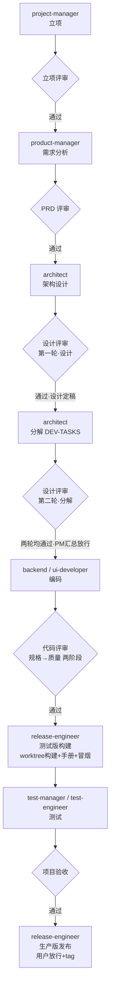

# virtual-team — 虚拟软件开发团队插件

按 `statement.txt` 描述的软件开发团队与流程，为 CodeBuddy / WorkBuddy 构建的可编排插件：**12 个角色 agent + 24 个技能 skill + 13 个工作流命令 + 37 个交付物模版**，覆盖 立项 → 需求 → 设计 → 编码 → 评审 → 测试 → 验收 → 发布 全流程。

插件在设计上遵循业界成熟实践：**证据先于结论**（验证后才声称完成）、**两阶段代码评审**（先规格符合性、后代码质量）、**完成状态协议**（DONE/BLOCKED 等必报）、**决策简报格式**（提问结构化）、**用户主权**（模型建议、用户决定）、**评审闭环**、**最简代码 / YAGNI**、**反合理化红线**。规则集中在 `rules/`，所有角色开工前必读。

## 目录结构

> 上半段（`virtual-team-plugin/` 至 `scripts/`）是**插件自身文件**；`design/`、`pages/`、`board/`、`docs/ src/ review/ test/ release/`、`build/` 是**目标项目运行时目录约定**（见 `rules/team-charter.md` §3），不随插件包分发。

```
virtual-team-plugin/
├── .codebuddy-plugin/
│   ├── plugin.json                    # 插件清单
│   └── marketplace.json               # 单插件自市场（可作为本地 marketplace 安装）
├── rules/
│   ├── team-charter.md                # 团队公约：角色纪律、编号规范、目录结构、评审闭环
│   ├── engineering-discipline.md      # 工程纪律：证据先于结论、两阶段评审、完成状态协议、YAGNI、版本控制
│   ├── decision-brief.md              # 决策简报格式：向用户提问的统一结构（轻量/完整两档）
│   └── storage-track.md               # 存储规则：JSON 单轨唯一规则源
├── agents/                            # 12 个角色
│   ├── project-manager.md     product-manager.md   architect.md
│   ├── backend-developer.md   ui-developer.md      code-reviewer.md
│   ├── test-manager.md        test-engineer.md     release-engineer.md
│   └── prd-reviewer.md design-reviewer.md  project-reviewer.md
├── skills/                            # 24 个技能
│   ├── planning / business-analysis / prd / prd-review
│   ├── architecting / data-modelling / general-design / task-breakdown / design-review / datamodel-review
│   ├── code-review
│   ├── case-design / case-instantiate / case-running / case-structure / prd-structure
│   ├── test-data-gen / test-rebuild / nfr-testing
│   ├── diagramming / doc-writing / accepting / prototype / releasing
├── commands/                          # 13 个工作流入口
├── templates/                         # 37 个交付物模版
├── schemas/                           # 8 个运行时产物 JSON Schema（verify_artifacts 消费）
├── scripts/
│   ├── verify_plugin.py               # 插件结构校验（提交前）
│   ├── verify_artifacts.py            # 运行时产物校验（JSON 单轨 + --stage 阶段契约）
│   ├── id_alloc.py                    # 编号分配（13 类编号 + 查重校验，永不复用）
│   └── gen_docs.py                    # 派生文档生成（RTM / 测试度量，禁手改）
├── design/                            # 设计交付（全局 + 组件）
│   ├── ARCH.md / ARCH-NFR.md / DATABASE.md / INTERFACE.md / LOGGER.md / DEV-TASKS.md
│   └── $COMPONENT/  interface.md / func.md（过大按 $MODULE/func.md 拆）/ database.md
├── pages/prototype/$COMPONENT/        # 组件界面原型 + 页面索引（运行时产出）
├── board/                             # 进度看板存放（运行时产出）
├── docs/ src/ review/ test/ release/   # 各阶段交付目录约定（design 见上）
└── build/                             # 临时/中间文件（禁止污染交付目录）
```

## 角色与流程



> **设计评审 = 一个门禁、两轮检查、一个放行点**：第一轮按组件评设计（角度 1–10/12）→ 设计修订定稿 → 架构师产出 `design/DEV-TASKS.md` → 同一 design-reviewer 做第二轮分解评审（角度 11）→ 两轮结论合入同一批 `RV-DESIGN-*` 报告，PM 汇总两轮均通过才放行。**不新增独立门禁，顺序不可颠倒**。**测试版构建是测试准入条件**；测试环境、`RUN.envs`、并行边界与重建规则以 `rules/team-charter.md` §5 为唯一规则源，此处不复述。

| 阶段 | 角色 | 技能 |
|------|------|------|
| 立项 | project-manager | planning |
| 需求分析 | product-manager | business-analysis, prd, prototype, prd-structure, diagramming |
| 架构设计 | architect | architecting, data-modelling, general-design |
| 任务分解 | architect | task-breakdown |
| 编码 | backend-developer / ui-developer | — |
| 代码评审 | code-reviewer | code-review |
| 测试版构建 | release-engineer | releasing, doc-writing |
| 测试 | test-manager / test-engineer | case-design, case-instantiate, case-running, case-structure |
| 验收 / 生产版发布 | project-reviewer / release-engineer | accepting, releasing, doc-writing |

## 命令

| 命令 | 说明 |
|------|------|
| `/vt-start` | 启动团队，从立项推进完整流程（可传入立项简报文件路径，缺失项自动追问） |
| `/vt-kickoff` | 立项，产出立项报告 |
| `/vt-prd` | 需求分析（产出 PRD） |
| `/vt-design` | 架构设计 |
| `/vt-coding` | 编码（按模块） |
| `/vt-code-review` | 代码评审（两阶段） |
| `/vt-build-test` | 测试版构建（测试准入：worktree 构建 + 手册 + 冒烟） |
| `/vt-test` | 测试（前置：`/vt-build-test` 已完成） |
| `/vt-nfr-test` | NFR 独立评估（性能/安全/兼容，仅参考报告） |
| `/vt-release` | 生产版发布（验收通过后：用户放行 + tag） |
| `/vt-accept` | 项目验收 |
| `/vt-status` | 更新并展示进度看板 |
| `/vt-review` | 通用评审入口（PRD/设计/数据模型） |

## 技能触发索引

> 本插件不使用 `triggers` 字段（CodeBuddy 技能 frontmatter 只认 `name`/`description`），触发词写在每个技能的 `description` 里。下表是人工索引，便于检索"什么场景该用哪个技能"。

| 场景 / 触发词 | 技能 | 负责角色 |
|--------------|------|---------|
| 新项目立项、项目定位、范围/约束/里程碑 | `planning` | project-manager |
| 业务建模、角色权限、业务流程、实体状态机、模块划分 | `business-analysis` | product-manager |
| 功能点定义、PRD、非功能需求、数据字典、需求追溯 | `prd` | product-manager |
| PRD 评审、需求质量检查 | `prd-review` | prd-reviewer |
| 界面原型、线框图、交互草图 | `prototype` | product-manager |
| 功能点结构化、PRD 追踪清单 | `prd-structure` | product-manager |
| 架构设计、技术选型、组件划分、部署视图 | `architecting` | architect |
| 数据库设计、ER 图、DDL、索引 | `data-modelling` | architect |
| 组件功能/接口设计（含算法与日志事件）、全局接口契约与日志规范 | `general-design` | architect |
| 开发任务分解、按模块切分任务、依赖与并行组 | `task-breakdown` | architect |
| 设计评审、架构评审、任务分解评审 | `design-review` | design-reviewer |
| 数据模型专项评审、表结构/DDL 评审 | `datamodel-review` | design-reviewer |
| 代码评审、规格符合性 + 代码质量两阶段 | `code-review` | code-reviewer |
| 测试方案、测试用例（CASE-<组件>-NNN）设计 | `case-design` | test-manager / test-engineer |
| 执行测试、跑用例、缺陷跟踪、测试报告 | `case-running` | test-engineer |
| 建 RUN、用例×数据配对成可执行实例、交审定 | `case-instantiate` | test-engineer |
| 用例结构化、覆盖率矩阵 | `case-structure` | test-engineer |
| NFR 独立评估（压测/扫描/故障注入）、NFR 报告 | `nfr-testing` | test-manager / test-engineer |
| 画图（架构图/ER/流程/时序/状态/甘特），统一 Mermaid | `diagramming` | 全体 |
| 安装/发布/用户手册、配置说明 | `doc-writing` | release-engineer |
| 项目验收、立项评审（总体评估） | `accepting` | project-reviewer |
| 构建发布组件、打包部署、标记测试版/生产版 | `releasing` | release-engineer |

## 核心规范

**规则加载**（`rules/` 的路径基准）

- 规则文件随插件分发，位于**插件安装根目录** `rules/`，**不复制到目标项目**；目标项目目录树中没有 `rules/`。
- 主会话 `/vt-start` 先定位插件根 `$PLUGIN_ROOT` 并写入看板头部；PM 派发每个子代理时把该路径注入任务输入，子代理按 `$PLUGIN_ROOT/rules/xxx.md` 读取。完整约定见 `rules/team-charter.md` §0。
- 插件 Markdown 内容不做变量插值，框架变量（如 `${CODEBUDDY_PLUGIN_ROOT}`）在子代理环境未注入，**不得依赖其自动展开**。

**团队公约**（`rules/team-charter.md`）

- **编号**：组件 `$COMPONENT` ⊃ 模块 `$MODULE`（均 snake_case）。业务 `biz-<组件>-<模块>-NNN`、功能点 `fr-<组件>-<模块>-NNN`（固定 4 段，无模块用 `all`）、用例 `CASE-<组件>-NNN`、数据单元 `TD-<组件>-NNN`、变更 `CR-<组件>-NNN`、缺陷 `BUG-<组件>-NNN`；执行轮 `RUN-NNN`（test-manager 创建）；实例计划行 `P-xxx`（全局唯一）；执行明细 `{plan_ref}-{seq}`（如 `P-003-1`，重跑序号递增——零撞号）。
- **纪律**：职责边界、文件化输入输出、禁止猜测、目录纯净、**任务五步流程**（计划→用户确认→批准后实施→校验→完成报告，微任务可合并确认批准）、交付物须评审、图形用 Mermaid。
- **门禁**：无 P0/P1 不得进入下一阶段；测试需覆盖全部功能点。
- **发布**：**用户一次显式放行**方可为生产版并打 tag（用户是唯一真人签字点；AI 角色评审结论为输入材料，见 charter §4 / §8）。

**工程纪律**（`rules/engineering-discipline.md`）

- **证据先于结论**：没有本次验证证据，不得声称"完成/通过/修好"。
- **可执行校验**：项目必须有 `scripts/verify.sh`（`--fast` / 全量两档）；TASK-DONE 附日志，门禁以退出码为准（discipline §14）。
- **两阶段评审**：先规格符合性（功能编号全覆盖、无多做漏做），后代码质量。
- **完成状态协议**：收尾必报 `DONE` / `DONE_WITH_CONCERNS` / `BLOCKED` / `NEEDS_CONTEXT`；3 次失败必上报。
- **否定性断言需证据**："做不到/不可能"也要给原文错误或实测；便宜探针先跑再问。
- **混淆协议**：高风险歧义 STOP，给 2–3 选项 + 权衡。
- **用户主权**：模型给建议、用户做决定；不擅自改既定方向。
- **接收评审**：先验证、先澄清，再动手；禁止表演式附和。
- **最简代码 / YAGNI**：不做需求外的抽象与扩展点。
- **反合理化**：常见借口（"太简单不用测""我手动测过了"）已显式封堵。

**决策简报**（`rules/decision-brief.md`）

- 向用户提问/确认统一用 `D<N>` **最小简报**（选项 + 建议 + 选错代价，`rules/decision-brief.md`）；**默认最小格式**，不可逆操作须显式确认，未响应转 `NEEDS_CONTEXT` 收束。
- 工具不可用时 prose 降级；**不可逆/破坏性操作必须显式确认**，含糊回复视为未确认。

- **存储规则**（`rules/storage-track.md`）

- 测试数据 **JSON 单轨**（`rules/storage-track.md` 唯一规则源）：立项时创建 `test/STORE-CONFIG.json`（`store` 固定 `json`），**无需选轨、无需迁移**；技能开工按 charter §0 章节索引读对应节。

**流程档位**（`rules/team-charter.md` §9）

- YAGNI 也适用于流程：立项时定档（**微项目 / 标准 / 完整**，默认标准档），决定评审合并、原型/NFR 轨/测试分片等裁剪项；证据先于结论、verify 门禁、P0/P1 阻塞、缺陷闭环、**发布用户一次显式放行**为**不可裁红线**。

## 安装

### 方式一：作为本地 marketplace 安装（推荐）

```bash
codebuddy plugin marketplace add <本目录绝对路径> -n virtual-team-marketplace
codebuddy plugin install virtual-team@virtual-team-marketplace -s user
```

### 方式二：本地开发直挂（仅调试用）

```bash
codebuddy --plugin-dir <本目录绝对路径>
```

安装后若插件未激活，在连接器管理页右上角的「自定义连接器」入口对该插件点击「信任」。

## 说明

- 本插件的角色定义基于 `statement.txt`；其中 **独立设计评审员（#10）** 与 **独立项目评审员（#11）** 在原文中未展开，已按其职责定位与流程要求补充定义（见对应 agent 文件顶部注记）。
- 原文列出的 **bug-reporting（缺陷报告）/ bug-fixing（缺陷修改）** 两技能未单独设立：缺陷报告并入 `case-running`（失败 EXEC → 建 BUG → 回归验证闭环），缺陷修复并入开发者职责（修复 → 回报 → 测试侧 verify_pass 关闭）。可按需拆分。
- 原文的 **case-running** 已拆为两个技能：`case-instantiate`（配对生成**可执行实例**，交审定）与 `case-running`（执行已审定实例 + 记录 EXEC + 缺陷 + 汇总）。拆分依据：实例化（设计型产物，需审定）与执行（运行型产物，追加式）性质不同，中间夹着 test-manager 审定的真实门禁。
- 目录约定、编号规范、评审闭环等原文未明确处，采用团队公约统一补齐，可按需调整 `rules/team-charter.md`。
- `rules/engineering-discipline.md` 与 `skills/code-review` 为工程实践增强，来源：Anthropic Skill 编写最佳实践、superpowers 系列技能（TDD/两阶段评审/验证先于完成）。可按需调整。
- **测试版构建**（两阶段发布之阶段一）为对原文发布流程的增强：代码评审闭环后即构建，作为测试环境来源——解决"测试需要安装手册但手册在发布阶段才产出"的时序倒挂。
- **测试执行协调**：RUN 头由 test-manager 创建（消除多分片并发建头竞态）；exec_id 采用复合格式 `{plan_ref}-{seq}`（plan_ref 全局唯一 → 并行分片零撞号）；轮次汇总由 `test-rebuild` 从 EXEC 派生（RUN 头为纯计划态，不回写）。
- **读取分层**：`ARCH.md`（开发者主线）/`ARCH-NFR.md`（非功能）、`DATABASE.md`（全局规范）/`$COMPONENT/database.md`（表明细）、`INTERFACE.md`（契约）/`$COMPONENT/interface.md`；agent 输入按「必读/按需/禁读」三档声明，读取纪律见 `rules/engineering-discipline.md` §15。
- **设计分层**：ARCH/DATABASE/INTERFACE/LOGGER 为全局单件但须内部索引/分节；功能设计按组件 `func.md`（FR > 12 或 > 300 行按模块拆），接口按组件 `interface.md`；算法与日志事件并入 FUNC；设计与 PRD 评审按组件出报告。
- **工程技术增强**：ARCH 增容量估算/威胁建模/可观测性；INTERFACE 增横切契约（版本/幂等/超时/重试等）；DATABASE 增 expand-contract 迁移；发布增 `RELEASE-PLAN`/SHA256/SBOM/回滚演练/发布后验证；DEV-TASKS 增 `ENABLER` 类型与相对规模。

### statement → 实现差异对照表

> `statement.txt` 为原始需求源；实现过程中按评审与裁决做了以下增强/修正，**以实现为准**：

| # | statement 原文 | 实现现状 | 依据 |
|---|--------------|---------|------|
| 1 | 评审员 #10（设计）/ #11（项目）未展开 | 已补充完整定义 | 职责定位 + 流程要求反推 |
| 2 | 技能列表含 bug-reporting / bug-fixing | 并入 case-running 与开发者职责 | 闭环本身就是缺陷流程，不单设技能 |
| 3 | case-running 单技能 | 拆为 case-instantiate + case-running | 实例化需 TM 审定门禁，与执行性质不同 |
| 4 | 测试在发布之前、手册在发布产出 | 新增**测试版构建**环节（代码评审闭环后），手册基于真实构建 | 消除时序死锁（评审 D1） |
| 5 | 功能点编号 `fr-$MOD-xxx` | `fr-$COMPONENT-$MODULE-NNN` 固定 4 段（组件⊃模块，snake_case，无模块用 all） | 组件模块层级改版（可机械解析） |
| 6 | test-manager"将测试缺陷发送给开发工程师" | TM 判定并登记 assigned_to（落 BUG 单），**实际派发由 PM 执行** | 子代理无消息通道，派发权唯一归 PM |
| 7 | "变更流程：缺陷修复流程："（原文截断） | CR 变更五步闭环（charter §5.1）+ BUG 状态机闭环 | 原文缺失，最小闭环补齐 |
| 8 | 开发者完成任务后无明确汇报要求 | TASK-DONE 标准报告（含 verify 结果 + commit hash + 状态自评），PM 核对回写看板 | 完成闭环 + 可执行校验 + 看板单一写者 |
| 9 | 发布"从 git 拉取分支" | 全新 worktree 从**主干**构建（测试版/生产版两阶段，tag 打在主干） | 单主干版本控制纪律（discipline §13） |
| 10 | 产物称"需求说明书/规格说明书"，结构化称 req | 统一标准化为 **PRD**：技能 `requirement→prd`、`req-structure→prd-structure`、`requirement-review→prd-review`；文件 `spec*.md→prd*.md`、`req.json→prd.json`；目录 `docs/requirements/→docs/prd/`；SQL 契约 `req_*→prd_*`（acceptance-v3）；命令 `/requirements→/vt-prd` | 术语标准化（消除 req/spec/PRD 三套用语分裂） |
| 11 | 原文无独立 NFR 测试 | 新增 **NFR 独立轨**：`test/nfr/`（NFR-CASE / NFR-TD / NFR-RUN / NFR-RPT），`/vt-nfr-test` 入口；仅参考报告，不阻塞 FR 流程与发布 | 技术评审（用户裁决：独立轨、仅报告） |
| 12 | 设计文档为单文件（FUNC/INTERFACE 等） | 设计按组件/模块分层：全局 ARCH/DATABASE/INTERFACE/LOGGER + 组件 `func.md`/`interface.md`；FUNC 超阈值按模块拆；算法与日志事件并入 FUNC；设计与 PRD 评审按组件出报告 | 技术评审（设计分层） |
| 13 | 全局设计文档被全量加载（DATABASE/ARCH 每次 spawn 全读） | 按读者/消费边界拆分：`ARCH.md`（开发者）+ `ARCH-NFR.md`（架构/评审/测试/发布）；`DATABASE.md` 只留全局概览，表结构下沉 `$COMPONENT/database.md`；agent 输入改「必读/按需/禁读」三档 + 读取纪律（discipline §15） | 上下文成本评审（单次 spawn 降约 38%） |

## 校验

**插件结构校验**（提交前，无需第三方依赖）：

```bash
python scripts/verify_plugin.py
```

校验项：JSON 合法性、技能/角色 frontmatter 与目录一致、plugin.json 路径存在、术语黑名单（legacy `spec`/`req` 用语）、版本三处一致、README 计数与实际一致、模板引用存在。失败退出码 1，输出 `规则 | 位置 | 明细`。

**运行时产物校验**（对开发中的项目跑，门禁以退出码为准）：

```bash
python scripts/verify_artifacts.py <项目根目录>
```

校验项：`schemas/` 下 8 个 JSON Schema 覆盖 STORE-CONFIG / PRD 分片 / 用例分片 / TD 注册表 / RUN 头 / EXEC-PLAN / EXEC 明细行 / BUG 单；跨产物闭合（fail→BUG 回指、blocked→evidence、exec_id 全局唯一、plan_ref 同 RUN 回指、P0/P1 修复评审与验证证据）；`--stage` 阶段必需产物契约；`derived-docs` 派生文档（RTM 与测试度量均按 JSON 重算后**逐字比对**，手改或源已变即 FAIL；RPT/NFR-RPT 骨架只查生成声明）。阶段未到的产物 SKIP 不算失败，但**未声明阶段且全 SKIP 判 FAIL**；`test/STORE-CONFIG.json` 缺失即 FAIL（fail-closed，对齐 storage-track §0）。

**编号分配**（记账字段不靠 AI 手写，永不复用、账本防重号）：

```bash
python scripts/id_alloc.py <项目根> fr --component order --module all --count 3
python scripts/id_alloc.py <项目根> bug --component order
python scripts/id_alloc.py <项目根> exec --plan-ref P-003
python scripts/id_alloc.py <项目根> check          # 全项目编号查重 + 格式校验
```

支持 13 类编号：`biz` / `fr` / `case` / `td` / `bug` / `cr` / `run` / `p` / `nfr-case` / `nfr-td` / `nfr-run` / `nfr-p` / `exec`。输出 JSON（`ids` 为分配结果）；分配结果记入 `test/trace/id-ledger.json`，删除产物也不会重号。组件/模块名强制 snake_case（含连字符直接报错退出 2）。

**派生文档生成**（人读文档不再手写，避免"文档说一套、JSON 是另一套"）：

```bash
python scripts/gen_docs.py --root . --type rtm       # docs/prd/RTM.md（每次覆盖）
python scripts/gen_docs.py --root . --type metrics   # test/report/test-metrics-RUN-xxx.md（每次覆盖）
python scripts/gen_docs.py --root . --type report    # RPT 骨架（存在即跳过，留人工结论）
python scripts/gen_docs.py --root . --type nfr       # NFR-RPT 骨架（同上）
python scripts/gen_docs.py --root . --type all --check   # 只比对；陈旧（手改/源已变）退出 1
```

分两类：**纯派生**（RTM、测试度量）每次重写，手改必被 `derived-docs` 判 FAIL；**骨架+人工结论**（RPT、NFR-RPT）只在缺失时生成，避免覆盖人工叙事。指标口径见 `templates/TEST-METRICS.md`，其中「重开率」因 BUG 无状态历史字段而明确标注**不可得**，不填 0。

## 许可证

MIT，见 [LICENSE](LICENSE)。
