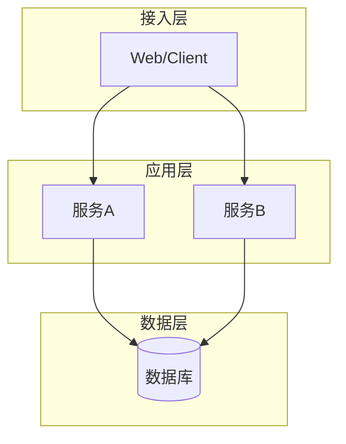
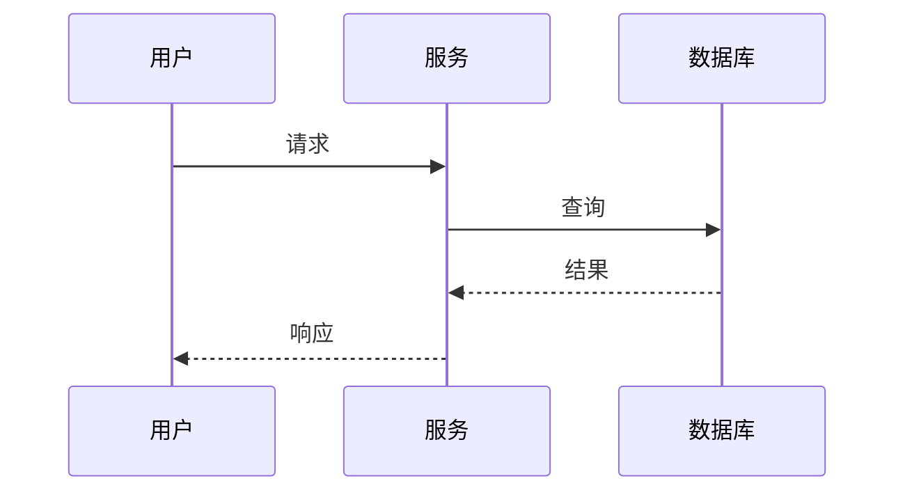
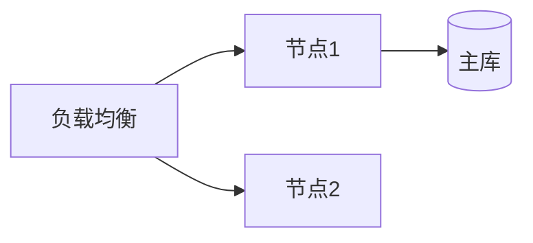

# 架构设计：$PROJECT_NAME

> 产出角色：architect ｜ 存放：design/ARCH.md
> **读者**：开发者必读（技术栈/架构/组件/时序/部署/ADR/追溯）。
> **非功能内容**（容量估算、威胁建模、可观测性）在 `design/ARCH-NFR.md`——开发者默认不读，仅在任务含性能/安全验收条件时按需查阅。

## 1. 技术栈选型

| 类别 | 选型 | 版本 | 理由 | 备选与被否决原因 |
|------|------|------|------|-----------------|
| 语言 | | | | |
| 框架 | | | | |
| 存储 | | | | |
| 依赖库 | | | | |

## 2. 系统架构

（图注：说明分层与职责）

## 3. 组件设计

| 组件 | 职责 | 输入 | 输出 | 依赖 |
|------|------|------|------|------|
| | | | | |

### 3.1 设计文件索引

> **读者入口**：按组件定位到设计文件，不需要扫描 `design/` 目录。

| 组件 | 接口设计 | 功能设计 | 数据库设计 |
|------|----------|----------|-----------|
| $COMPONENT | `design/$COMPONENT/interface.md` | `design/$COMPONENT/func.md`（按模块拆时 `$MODULE/func.md`） | `design/$COMPONENT/database.md` |

## 4. 关键交互时序

## 5. 部署视图

**环境与配置**：各环境的差异项、配置来源（环境变量/配置文件）、密钥注入方式（禁入代码库）。

## 6. 设计决策记录（ADR）

| 编号 | 决策 | 背景 | 结论 | 影响 |
|------|------|------|------|------|
| ADR-001 | | | | |

## 7. 可追溯性

| 组件/模块 | 关联功能编号 | 设计文件 | 章节 |
|-----------|-------------|----------|------|
| $COMPONENT / $MODULE | fr-$COMPONENT-$MODULE-NNN | `design/$COMPONENT/func.md` | §3.1 |
