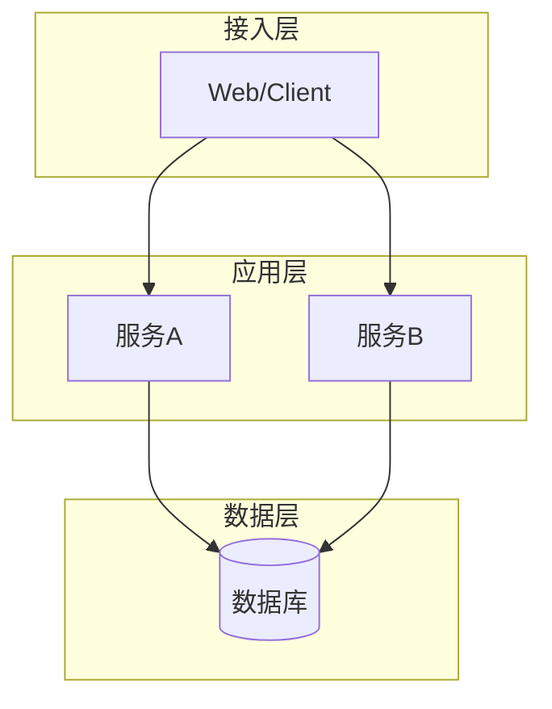
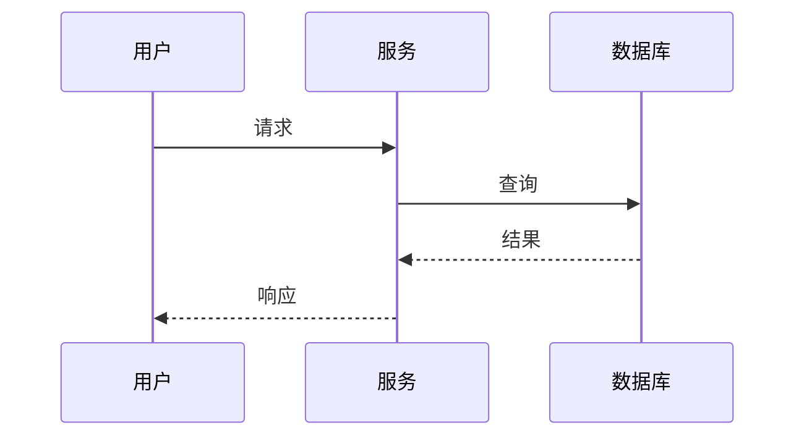
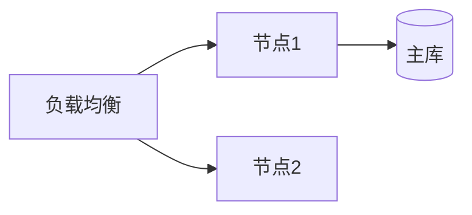

# 架构设计：$PROJECT_NAME

> 产出角色：architect ｜ 存放：design/ARCH.md

## 1. 技术栈选型

| 类别 | 选型 | 版本 | 理由 | 备选与被否决原因 |
|------|------|------|------|-----------------|
| 语言 | | | | |
| 框架 | | | | |
| 存储 | | | | |
| 依赖库 | | | | |

## 2. 系统架构

（图注：说明分层与职责）

## 3. 组件设计

| 组件 | 职责 | 输入 | 输出 | 依赖 |
|------|------|------|------|------|
| | | | | |

### 3.1 设计文件索引

| 组件 | 接口设计 | 功能设计 | 数据库章节 |
|------|----------|----------|-----------|
| $COMPONENT | `design/$COMPONENT/interface.md` | `design/$COMPONENT/func.md`（按模块拆时 `$MODULE/func.md`） | `design/DATABASE.md#…` |

## 4. 关键交互时序

## 5. 部署视图

## 6. 非功能支撑

| 需求编号 | 架构措施 |
|---------|---------|
| NF-P-xxx | 缓存 / 异步 / 索引 |
| NF-S-xxx | 认证网关 / 加密 / 审计 |

## 7. 容量与资源估算

> 判据：有并发/容量类 NFR（NF-P-*）或用户规模 > 1k 时必填；纯内部工具可写"不适用 + 理由"。

| 维度 | 估算值 | 依据（用户规模 × 行为假设） | 验证方式 |
|------|--------|------------------------------|----------|
| 峰值 QPS / TPS | | | 压测 |
| 并发连接 | | | 压测 |
| 存储（首年 / 年增） | | 记录数 × 单条大小 | 容量评估 |
| 带宽（入口 / 出口） | | QPS × 平均包大小 | 监控 |
| 计算资源（实例数 × 规格） | | QPS × 单请求耗时 ÷ 目标利用率 | 压测 |
| 缓存容量 | | 热数据比例 × 数据量 | 命中率验证 |

## 8. 安全设计（威胁建模）

> 判据：对外暴露、处理个人信息/资金、多租户时必填；否则写"不适用 + 理由"。

**信任边界**：

**STRIDE 威胁与缓解**：

| 威胁类型 | 场景 | 影响 | 缓解措施 | 验证方式 |
|----------|------|------|----------|----------|
| Spoofing 身份伪造 | | | 认证/签名 | 用例 |
| Tampering 篡改 | | | 完整性校验/权限 | 用例 |
| Repudiation 抵赖 | | | 审计日志 | 日志抽样 |
| Information disclosure 泄露 | | | 加密/脱敏/最小权限 | 扫描 |
| Denial of service 拒绝服务 | | | 限流/超时/降级 | 压测 |
| Elevation of privilege 提权 | | | 授权模型/越权校验 | 渗透 |

**认证与授权**：模型（RBAC/ABAC）、会话/令牌、租户隔离。

**密钥与配置**：密钥来源（环境变量/密钥管理）、轮换策略、禁止入库。

**依赖供应链**：依赖来源、版本锁定、漏洞扫描、许可证。

## 9. 可观测性设计

> 判据：有可用性/性能 NFR 或需要线上排障时必填。

**SLI / SLO**：

| SLI | 定义 | SLO | 告警阈值 | 数据来源 |
|-----|------|-----|----------|----------|
| 可用性 | 成功请求 ÷ 总请求 | ≥ 99.9% | 5 分钟 < 99% | 指标 |
| 延迟 | P95 | ≤ 200 ms | 5 分钟 > 300 ms | 指标 |
| 错误率 | 5xx ÷ 总请求 | ≤ 0.1% | 5 分钟 > 1% | 指标 |

**三支柱**：

| 支柱 | 设计要点 | 落地位置 |
|------|----------|----------|
| 日志 | 结构化、traceId、脱敏 | `design/LOGGER.md` |
| 指标 | 关键 SLI、业务指标、采集间隔 | 本文件 + 代码埋点 |
| 追踪 | 入口生成 traceId、跨服务透传 | 本文件 + 中间件 |

**健康检查**：liveness / readiness 端点与判定。

**告警路由**：级别、通知渠道、值班/升级。

## 10. 设计决策记录（ADR）

| 编号 | 决策 | 背景 | 结论 | 影响 |
|------|------|------|------|------|
| ADR-001 | | | | |

## 11. 可追溯性

| 组件/模块 | 关联功能编号 | 设计文件 | 章节 |
|-----------|-------------|----------|------|
| $COMPONENT / $MODULE | fr-$COMPONENT-$MODULE-NNN | `design/$COMPONENT/func.md` | §3.1 |
