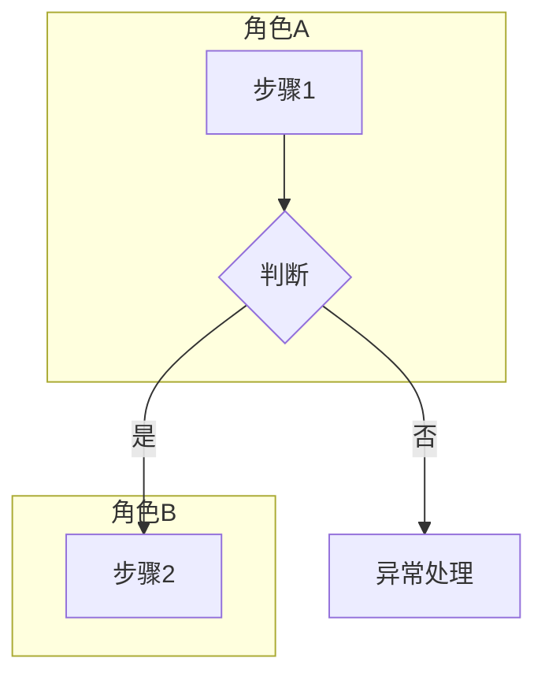
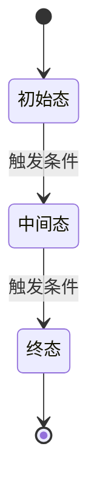

# 业务分析说明书：$COMPONENT / $MODULE

> 模版：BA-MOD.md（**BA = 业务分析 Business Analysis**，由 `business-analysis` 技能产出）｜ 产出角色：product-manager ｜ 存放：docs/prd/$COMPONENT/$MODULE/ba.md（组件不细分模块时省略 $MODULE/）
>
> 命名关系：模板/文件/技能同源（`BA-MOD` → `ba.md` ← `business-analysis`）；文件内的业务编号仍用 `biz-$COMPONENT-$MODULE-NNN`，二者不同前缀是刻意的（同 `prd.md` 与 `fr-` 的关系）。
>
> 本文档**禁止散文叙述**：流程用 Mermaid、规则用决策表、异常用清单、状态用表格。

## 1. 模块说明

（模块职责、边界、与其它模块的关系；说明本文档覆盖的 AS-IS 与 TO-BE 范围）

## 2. 业务清单

| 业务编号 | 业务名称 | 涉及角色 | 流程规模（节点数） |
|---------|---------|---------|------------------|
| biz-$COMPONENT-$MODULE-001 | | | |

---

## 3. 业务详述

> 每项业务复制以下小节。四段式缺一不可。

### biz-$COMPONENT-$MODULE-001 （业务名称）

| 项 | 内容 | 来源 |
|----|------|------|
| 业务说明 | | |
| 涉及角色 | | |
| 触发条件 | | |

**前置条件**

- 

**主流程**（泳道图，按角色分 `subgraph`；单图 ≤ 15 节点，超出拆子流程，每个菱形必须有否分支）

**异常流**（详见 §4 异常场景清单，此处列本业务的异常分叉入口）

| 异常编号 | 触发点 | 去向 |
|---------|--------|------|
| EX-001 | | |

**后置条件**

- 成功：
- 失败：

---

## 4. 决策表（业务判断点全集）

> 提取法：逐节点扫，凡「依据条件走向不同结果」即判断点，全部登记；含藏在文字里的隐性判断。

### 4.1 判断点清单

| 判断点 | 位置（节点/环节） | 条件数 | 规则数 | 不可行组合数 |
|--------|------------------|--------|--------|-------------|
| J-001 | | | | |

### 4.2 决策表

| 规则 | 条件1： | 条件2： | 条件3： | 结果 |
|------|--------|--------|--------|------|
| R1 | | | | |
| R2 | | | | |
| R3 | —（不可行：原因） | | | — |

> 硬性：`n` 个二值条件须覆盖 `2^n` 组合；不可行组合填 `—` 并写原因；**禁止「其他情况按默认处理」**。

---

## 5. 异常场景清单

| 异常编号 | 场景 | 触发条件 | 系统行为 | 补偿动作 | 责任人 | 来源 |
|---------|------|---------|---------|---------|--------|------|
| EX-001 | | | | | | |

> 四类问法逐节点过：输入不合法 / 状态不允许 / 依赖失败 / 人为中断。责任人不明 → `[TBD: 待确认责任人]`。

---

## 6. 业务实体

> 每个实体一节。**只出业务口径**，正式字段定义（类型/长度/索引）属 `prd` 的 `dict.md`。

### 实体：（实体名）

| 属性 | 业务含义 | 取值约束 |
|------|---------|---------|
| | | |

**状态机**

| 当前状态 | 触发事件 | 流转条件 | 后置状态 | 来源 |
|---------|---------|---------|---------|------|
| | | | | |

**非法迁移**（禁止的状态变化及原因）：列出。

---

## 7. 问题与风险

> 挑刺产出：矛盾、缺口、二义性。无则写「未发现」。**每条必须给去向**，不允许只列问题。

| 编号 | 类型 | 描述 | 影响 | 去向（问用户 / 转架构 / 待评审） | 状态 |
|------|------|------|------|-------------------------------|------|
| Q-001 | 矛盾 / 缺口 / 二义性 | | | | 待确认 / 已裁定 |

---

## 8. 待确认台账

> `[TBD]` 与 `[推断]` 汇总于此，逐条与用户过。**未清零不得进入 `prd` 阶段**（有假设 + 有责任人 + 有回填点者可例外，同 `prd` 的 gated 标准）。

| 编号 | 内容 | 类型 | 当前假设 | 责任人 | 回填位置 | 状态 |
|------|------|------|---------|--------|---------|------|
| TBD-001 | | TBD / 推断 | | | | 待确认 / 已确认 / 已回填 |

---

## 9. 业务-模块归属

| 业务编号 | 所属模块 |
|---------|---------|
| biz-$COMPONENT-$MODULE-001 | $COMPONENT / $MODULE |
