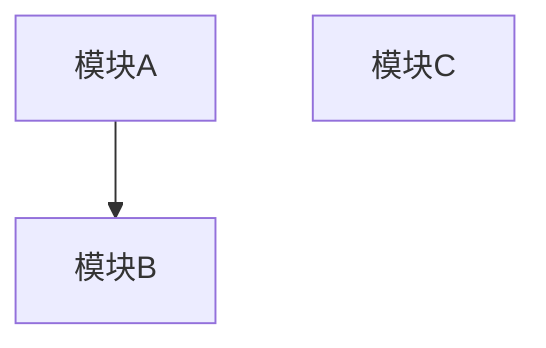
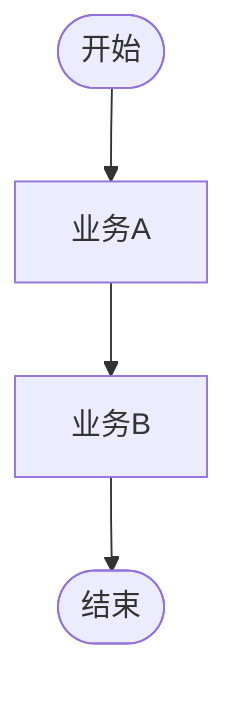

# 业务分析概览：$PROJECT_NAME

> 模版：BA-OVERVIEW.md（**BA = 业务分析 Business Analysis**）｜ 产出角色：product-manager ｜ 存放：docs/prd/overview.md
>
> 注意：本模板的交付物沿用 `overview.md` 通用名（全局概览，非 BA 阶段专属），与 `BA-MOD → ba.md` 的命名规则不同源，这是**刻意保留的例外**。

## 1. 系统定位

（系统解决什么问题，服务谁，一句话定位）

## 2. 使用用户与角色

| 角色 | 说明 | 主要权限 | 职责边界（不负责什么） | 来源 |
|------|------|---------|---------------------|------|
| | | | | |

## 3. 项目边界

### 3.1 系统负责
- 

### 3.2 系统不负责
- 

## 4. 高层模块划分

| 模块 | 名称 | 职责 | 依赖模块 |
|------|------|------|---------|
| $COMPONENT | $MODULE | | |

### 4.1 模块依赖图

## 5. 业务清单

| 业务编号 | 业务名称 | 所属模块 | 涉及角色 | AS-IS/TO-BE |
|---------|---------|---------|---------|-------------|
| biz-$COMPONENT-$MODULE-001 | | | | |

## 6. 业务全景流程

> 主干级即可，细节下沉到各模块 `ba.md`。单图 ≤ 15 节点。

## 7. 模块划分原则说明

（说明为什么这样划分：高内聚、低耦合的体现）

## 8. 材料清单与缺口

> 原料越原始越好。级别：A 原始材料 / B 二手消化稿 / C 用户口述 / D 无。

| # | 材料 | 级别 | 覆盖范围 | 与本文档的关联 | 缺口说明 |
|---|------|------|---------|---------------|---------|
| 1 | | | | | |

**仍缺的关键材料**：

- 

## 9. 全局待确认台账

> 仅收跨组件/全局级条目；模块级条目留在各 `ba.md` §8。

| 编号 | 内容 | 类型 | 当前假设 | 责任人 | 回填位置 | 状态 |
|------|------|------|---------|--------|---------|------|
| TBD-001 | | TBD / 推断 | | | | 待确认 / 已确认 |

## 10. 全局问题与风险

| 编号 | 类型 | 描述 | 影响 | 去向 | 状态 |
|------|------|------|------|------|------|
| Q-001 | 矛盾 / 缺口 / 二义性 | | | | |
