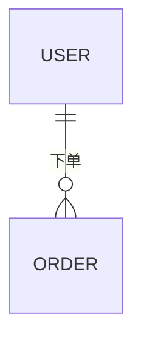

# 数据库设计（组件：$COMPONENT）：$PROJECT_NAME

> 产出角色：architect ｜ 存放：design/$COMPONENT/database.md
> **只写本组件的表**。全局数据规范（命名/主键/审计字段/字符集/软删/安全分级）见 `design/DATABASE.md` §2/§5，本文件不重复声明。
> 跨组件关系与引用方向见 `design/DATABASE.md` §3/§4。

## 1. 组件内 ER

> 只画本组件内部的实体关系。



## 2. 表清单

| 表名 | 模块 | 说明 | 对应实体 | 关联功能编号 |
|------|------|------|----------|-------------|
| | | | | |

## 3. 表结构详述

### 表：表名

| 字段 | 类型 | 允许空 | 默认值 | 约束 | 说明 |
|------|------|--------|--------|------|------|
| | | | | | |

## 4. 索引设计

| 索引名 | 类型（主键/唯一/普通/复合） | 字段 | 支撑的查询 / 功能编号 |
|--------|---------------------------|------|---------------------|
| | | | |

## 5. DDL

> 与 §3/§4 逐字对应；评审时以本节为准。

```sql
-- 表：表名
CREATE TABLE `xxx` (
  `id` BIGINT NOT NULL AUTO_INCREMENT COMMENT '主键',
  `created_at` DATETIME NOT NULL COMMENT '创建时间（UTC）',
  PRIMARY KEY (`id`)
) ENGINE=InnoDB DEFAULT CHARSET=utf8mb4 COMMENT='表说明';
```

## 6. 数据生命周期

| 表 | 增长量级 | 软删/归档 | 保留期 | 清理方式 |
|----|---------|-----------|--------|----------|
| | | | | |

## 7. 敏感字段

| 字段 | 级别（L2/L3/L4，见全局 §5） | 处理方式（加密/脱敏/审计） |
|------|---------------------------|---------------------------|
| | | |

## 8. 迁移与演进

> 判据：本组件已有存量数据，或表结构变更跨版本时必填；否则写"不适用 + 理由"。
> 跨组件的**发布顺序**由 `release/RELEASE-PLAN-<version>.md` 统一编排，本节只描述本组件表内的 expand-contract。

**策略：expand-contract**

| 阶段 | 动作 | 兼容性 | 回滚 |
|------|------|--------|------|
| Expand | 加新字段/新表（可空或默认值），双写 | 旧代码可运行 | 删新字段 |
| Migrate | 批量回填（幂等、限速、可断点续跑） | 新旧并存 | 停回填 |
| Switch | 读切新、写双写→单写 | 新旧兼容 | 切回旧读 |
| Contract | 删除旧字段/旧表（至少晚一个版本） | — | 备份恢复 |

- **验证**：迁移前后行数/校验和、关键查询 `EXPLAIN`、约束与索引有效性。
- **回滚**：禁止与代码发布同版本做 destructive 变更；回滚脚本与备份恢复须演练。
- **大表**：在线 DDL 或分批执行，避免长锁；写明预计耗时与窗口。
