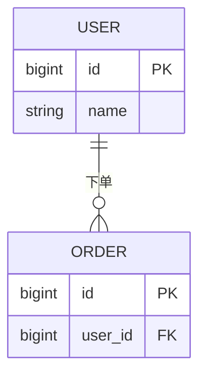

# 数据库设计：$PROJECT_NAME

> 产出角色：architect ｜ 存放：design/DATABASE.md
> **组织规则**：本文件为全局单文件，但**必须按组件/模块分节**（`## $COMPONENT / $MODULE`）；顶部维护索引，禁止把全部表混排。

## 0. 组件/模块索引

| 组件 | 模块 | 章节 | 表数量 |
|------|------|------|--------|
| $COMPONENT | $MODULE | §4.1 | |

## 1. 数据模型概览

（说明设计原则、范式取舍）

## 2. E-R 图



## 3. 表清单

| 表名 | 所属组件 | 所属模块 | 说明 | 对应实体 | 关联功能编号 |
|------|----------|----------|------|---------|-------------|
| | | | | | |

## 4. 表结构详述

> 按组件/模块分小节（`### $COMPONENT / $MODULE`），与 §0 索引一致；禁止把跨组件表混在同一节。

### 表：表名

| 字段 | 类型 | 允许空 | 默认值 | 约束 | 说明 |
|------|------|--------|--------|------|------|
| | | | | | |

**索引**

| 索引名 | 类型 | 字段 | 支撑的查询/功能编号 |
|--------|------|------|-------------------|
| | | | |

## 5. DDL

```sql
-- 表：表名
CREATE TABLE `xxx` (
  `id` BIGINT NOT NULL AUTO_INCREMENT COMMENT '主键',
  PRIMARY KEY (`id`)
) ENGINE=InnoDB DEFAULT CHARSET=utf8mb4 COMMENT='表说明';
```

## 6. 数据生命周期

（归档、分区、清理策略）

## 7. 安全

| 敏感字段 | 处理方式 |
|---------|---------|
| | |

## 8. 迁移与演进

> 判据：已有存量数据，或表结构变更跨版本时必填；否则写"不适用 + 理由"。

**策略：expand-contract**

| 阶段 | 动作 | 兼容性 | 回滚 |
|------|------|--------|------|
| Expand | 加新字段/新表（可空或默认值），双写 | 旧代码可运行 | 删新字段 |
| Migrate | 批量回填（幂等、限速、可断点续跑） | 新旧并存 | 停回填 |
| Switch | 读切新、写双写→单写 | 新旧兼容 | 切回旧读 |
| Contract | 删除旧字段/旧表（至少晚一个版本） | — | 备份恢复 |

- **发布顺序**：expand 迁移 → 部署新代码 → 回填完成 → 切换读 → 下个版本 contract。
- **验证**：迁移前后行数/校验和、关键查询 `EXPLAIN`、约束与索引有效性。
- **回滚**：禁止与代码发布同版本做 destructive 变更；回滚脚本与备份恢复须演练。
- **大表**：在线 DDL 或分批执行，避免长锁；写明预计耗时与窗口。
