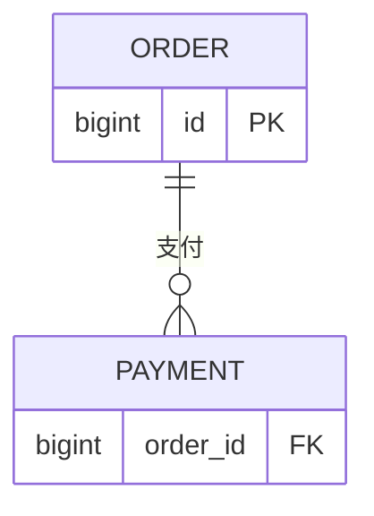

# 数据库设计（全局概览）：$PROJECT_NAME

> 产出角色：architect ｜ 存放：design/DATABASE.md
> **本文件只放全局内容**：索引、跨组件 ER、全局数据规范、跨组件引用约束。**表结构/DDL/索引/迁移一律下沉到 `design/$COMPONENT/database.md`**——读者只需读本组件那一份，避免全量加载。
> 全局与组件的边界：**所有组件都遵守的写这里；只属于某个组件的写组件文件。**

## 0. 组件数据索引

> 读者的第一入口：按组件定位到具体文件与表数，不需要打开组件文件就能判断相关性。

| 组件 | 数据设计文件 | 表数量 | 主要实体 | 章节锚点 |
|------|-------------|--------|----------|----------|
| $COMPONENT | `design/$COMPONENT/database.md` | | | `#表名` |

## 1. 数据设计原则

（范式取舍、何时反范式、主键/外键总体策略、软删 vs 硬删的全局取舍）

## 2. 全局数据规范

> 所有组件表必须遵守；组件文件不再重复声明。

| 项 | 规范 |
|----|------|
| 命名 | 表 `snake_case` 单数/复数统一（择一并写明）；字段 `snake_case`；索引 `idx_<表>_<字段>`；外键 `fk_<表>_<引用表>` |
| 主键 | 类型（自增 BIGINT / UUID / 雪花）、生成方式 |
| 审计字段 | `created_at` / `updated_at` / `created_by` / `updated_by` 是否统一 |
| 字符集与时区 | 库/表字符集、时间字段一律 UTC 存储 |
| 软删 | `deleted_at` 或 `is_deleted`；唯一索引如何与软删共存 |
| 金额与精度 | 金额类型（DECIMAL 精度）、汇率/单位约定 |
| 枚举 | 用 TINYINT 还是 VARCHAR；枚举值来源（数据字典） |
| 空值与默认值 | 禁止 NULL 的字段类别；默认值策略 |

## 3. 跨组件 ER 概览

> **只画跨组件的实体关系**（组件内 ER 在各组件 `database.md`）；无跨组件关系时写"各组件数据独立，无跨组件外键"。

## 4. 跨组件引用与约束

> 决定组件间的数据依赖方向；**禁止反向依赖**（下游组件不得被上游表引用）。

| 引用方组件.表 | 被引用组件.表 | 关系 | 删除策略 | 说明 |
|--------------|-------------|------|----------|------|
| | | FK / 逻辑引用 | RESTRICT / CASCADE / 置空 | |

- **外键策略**：物理外键还是应用层保证（择一并写明理由）。
- **跨组件事务**：是否允许跨组件强一致事务；不允许时的补偿方式（本地消息表 / 最终一致）。

## 5. 全局安全策略

> 敏感数据分级与处理原则；具体字段清单在各组件 `database.md` 的"敏感字段"节。

| 级别 | 判定 | 处理要求 |
|------|------|----------|
| L1 公开 | | |
| L2 内部 | | |
| L3 敏感（PII） | | 加密/脱敏/最小权限/审计 |
| L4 机密（凭证/资金） | | 加密存储 + 访问审计 + 禁止明文入日志 |
