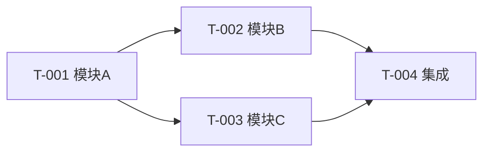

# 开发任务分解：$PROJECT_NAME

> 模版：DEV-TASKS.md ｜ 产出角色：architect ｜ 存放：design/DEV-TASKS.md
> **性质：规划物 + 派发建议**。本文件描述"拆成哪些任务、依赖关系、建议由哪类角色承担（**派发建议**）、需串行化的共享文件点"，**不含执行派发**（派发动作唯一归项目经理，见 `rules/team-charter.md` §5 术语）。

## 1. 说明

- 本文档在**设计评审第一轮通过、设计修订定稿之后**产出；随后提交设计评审第二轮（分解评审）。
- 分解粒度：**以模块为单位**，每个任务可独立开发与验收。
- 本文件是开发阶段的输入依据。

## 2. 任务清单

| 任务编号 | 类型 | 规模 | 所属模块 | 覆盖功能编号 | 设计依据 | 前置依赖 | 派发建议（建议执行角色） | 并行组 | 串行化提示 | 验收标准（DoD） |
|---------|------|------|---------|-------------|----------|---------|----------------------|-------|-----------|-----------------|
| T-001 | FR | M | $COMPONENT/$MODULE | fr-$COMPONENT-$MODULE-001, ...-002 | `design/$COMPONENT/func.md#3.1` | — | backend-developer | G1 | 写 `src/common/` 公共库 | |
| T-002 | FR | S | $COMPONENT2/$MODULE2 | fr-$COMPONENT2-$MODULE2-001 | `design/$COMPONENT2/func.md#3.2` | T-001 | ui-developer | G2 | — | |
| T-003 | ENABLER | S | infra | —（技术使能，无 FR） | — | — | backend-developer | G1 | `scripts/verify.sh` | `verify --fast` 全绿、可在空环境跑通 |

> 字段说明：
> - **类型**：`FR`（覆盖功能编号，按功能验收）/ `ENABLER`（技术使能项：verify/CI、DB 迁移脚本、可观测性接入、构建优化、脚手架——不挂 FR，但必须有独立 DoD）。
> - **规模**：`S / M / L` 相对规模（规划输入，**不是排期**）；由工作量与不确定性综合判断。
> - **设计依据**：该任务实现所依据的设计文件与章节（组件 `func.md` / `interface.md` / `database.md` / 全局 `DATABASE.md` 规范）；ENABLER 填 `—`。
> - **前置依赖**：必须先完成的任务编号；无则填 `—`。
> - **派发建议（建议执行角色）**：由任务性质推导（后端逻辑 → backend-developer；界面交互 → ui-developer）。**这是给项目经理的派发建议（决策输入），非最终指派**——派发动作唯一归项目经理。
> - **并行组**：由依赖拓扑推导，**同组任务无相互依赖，可并行**。
> - **串行化提示**：该任务会写哪些**共享文件**（构建配置、lockfile、公共库、同一 env 等），提示项目经理须与其他任务串行化；无则填 `—`。
> - 本表**不含**优先级与排期（属项目管理环节）。

## 3. 依赖拓扑

## 4. 并行组划分

| 并行组 | 任务 | 说明 |
|-------|------|------|
| G1 | T-001 | 无依赖，可立即开始 |
| G2 | T-002, T-003 | 依赖 T-001 完成，彼此独立可并行 |
| G3 | T-004 | 依赖 G2 全部完成 |

> 划分依据：同一并行组内任务之间**无依赖**；跨组按拓扑顺序推进。

## 5. 覆盖性校验

| 检查项 | 结果 |
|--------|------|
| 所有模块是否都有任务 | |
| 所有功能编号 `fr-$COMPONENT-$MODULE-NNN` 是否被 FR 任务覆盖 | |
| 所有 ENABLER 是否有独立 DoD | |
| 是否存在依赖环 | |
| 每个任务是否可独立验收 | |
| 每个任务是否标注类型与规模 | |
| 每个 FR 任务是否有设计依据 | |

## 6. 待确认项

| 编号 | 待确认内容 | 影响 | 状态 |
|------|-----------|------|------|
| Q-01 | | | |
