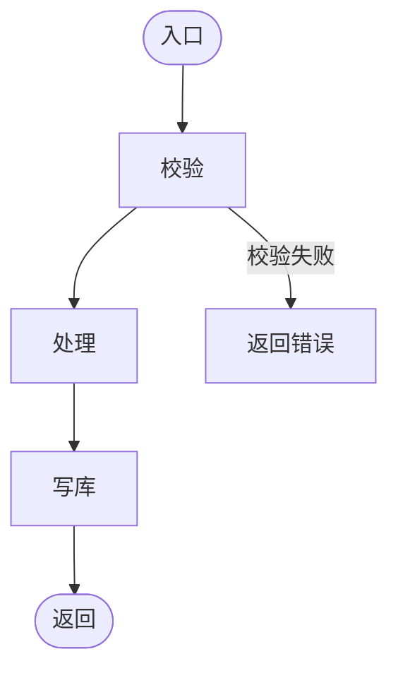

# 功能设计：$COMPONENT（$PROJECT_NAME）

> 模版：FUNC.md ｜ 产出角色：architect ｜ 存放：`design/$COMPONENT/func.md`
> **拆分规则**：组件 FR > 12 条，或本文件 > 300 行 → 按模块拆为 `design/$COMPONENT/$MODULE/func.md`；**拆分后不再保留组件级 func.md**（禁止双写）。
> **合并内容**：数据结构与算法、日志事件在本文件内成节，不再单独建文件。

## 1. 组件/模块信息

| 项 | 内容 |
|----|------|
| 组件 | $COMPONENT |
| 模块清单 | $MODULE1 / $MODULE2 / … |
| FR 数量 | |
| 是否按模块拆分 | 否（组件级） / 是（模块级） |

## 2. FR → 设计条目映射

| 功能编号 | 设计章节 | 覆盖说明 |
|----------|----------|----------|
| fr-$COMPONENT-$MODULE-NNN | §3.1 | |

> 未覆盖的 FR 必须在 §7 写明理由；无理由漏覆盖 = 设计缺陷。

## 3. 功能设计

### 3.1 fr-$COMPONENT-$MODULE-NNN（功能名称）

| 项 | 内容 |
|----|------|
| 对应功能编号 | fr-$COMPONENT-$MODULE-NNN |
| 所属组件/模块 | $COMPONENT / $MODULE |
| 功能说明 | |
| 依赖 | |
| 接口引用 | `design/$COMPONENT/interface.md#IF-xxx` |
| 异常路径 | |



## 4. 数据结构与算法（按需）

> 仅"重要、复杂"功能填写（判据：影响多组件，或含并发/事务一致性；见 `rules/team-charter.md` §5「复杂判据」）。无则写"不适用"。

### DSA-xxx（功能名称）

| 项 | 内容 |
|----|------|
| 关联功能编号 | fr-$COMPONENT-$MODULE-NNN |
| 问题描述 | |
| 约束 | |

**数据结构选型**

| 结构 | 选型 | 理由 | 空间复杂度 |
|------|------|------|-----------|
| | | | |

**算法描述**（步骤或伪代码）

```
function foo(input):
    ...
    return output
```

**复杂度与边界**

| 指标 | 值 | 说明 |
|------|----|------|
| 时间复杂度 | | |
| 空间复杂度 | | |

- 边界条件：

## 5. 日志事件

> 日志格式/目录/级别/脱敏/保留见 `design/LOGGER.md`；本节只声明本组件/模块记录哪些事件。

| 事件 | 级别 | 关键字段 | 脱敏 | 说明 |
|------|------|----------|------|------|
| | INFO | | | |

## 6. 模块交互


## 7. 追溯与缺口

| 功能编号 | 设计状态（已设计 / 未覆盖） | 说明 |
|----------|------------------------------|------|
| | | |
