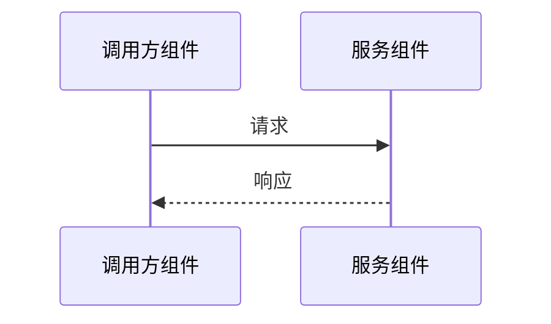

# 接口设计（全局）：$PROJECT_NAME

> 模版：INTERFACE.md ｜ 产出角色：architect ｜ 存放：`design/INTERFACE.md`
> **本文件只放两类内容**：① 横切契约（全局统一）；② 组件接口索引。具体接口见 `design/$COMPONENT/interface.md`（模版 `templates/INTERFACE-COMP.md`）。

## 1. 横切契约（全局）

> 适用于全部对外接口；单接口有例外须在该接口文件内显式说明。

| 项 | 规则 | 落地/校验 |
|----|------|-----------|
| 版本策略 | URL 版本 `/api/v1/...` 或 Header；v1/v2 并存期与下线时间 | 网关路由 |
| 兼容规则 | 只增不删字段；删除/改语义须升 major；客户端须忽略未知字段 | 契约测试 |
| 幂等 | 写操作/资金操作必须支持 `Idempotency-Key`；重复请求返回同一结果 | 用例 |
| 分页 | 统一 cursor 或 page/size；声明单页上限 | 用例 |
| 限流 | 按租户/用户/接口配额；超限返回 429 + `Retry-After` | 压测 |
| 超时 | 客户端超时 < 服务端处理上限；关键依赖独立超时 | 用例 |
| 重试 | 仅对幂等且可重试错误（5xx/超时）退避重试；设上限与抖动 | 用例 |
| 熔断/降级 | 依赖失败阈值、半开策略、降级返回 | 故障注入 |
| 错误分类 | 4xx 客户端 / 5xx 服务端 / 业务码三段式；错误体含 code/message/traceId | 契约测试 |
| 认证与租户 | 认证方式；租户隔离字段来源（禁止客户端传入） | 渗透 |

## 2. 组件接口索引

| 组件 | 接口文件 | 接口数量 | 说明 |
|------|----------|----------|------|
| $COMPONENT | `design/$COMPONENT/interface.md` | | |

> 索引必须与实际组件目录一致；新增组件须同步本表。

## 3. 跨组件接口时序（按需）

## 4. 接口与功能映射（全局汇总）

| 接口 | 组件 | 关联功能编号 |
|------|------|-------------|
| | | |
