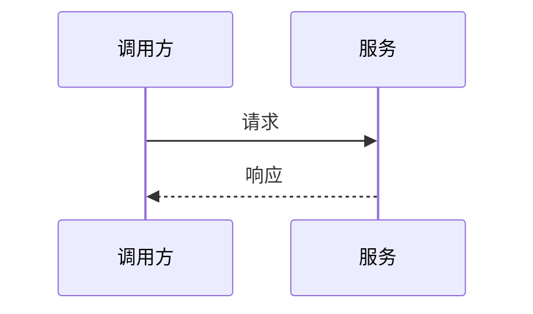

# 接口设计：$PROJECT_NAME

> 产出角色：architect ｜ 存放：design/INTERFACE.md

## 1. 对内接口（模块间）

### IF-INT-xxx （接口名）

| 项 | 内容 |
|----|------|
| 提供方模块 | |
| 调用方模块 | |
| 关联功能编号 | fr-$COMPONENT-$MODULE-NNN |
| 签名 | `func(arg1, arg2) -> ret` |
| 参数 | | 
| 返回 | |
| 异常 | |
| 说明 | |

---

## 2. 对外接口

### IF-EXT-xxx （接口名）

| 项 | 内容 |
|----|------|
| 协议 | REST / RPC / MQ |
| 方法与路径 | `POST /api/v1/xxx` |
| 版本 | v1（兼容策略见 §3） |
| 关联功能编号 | fr-$COMPONENT-$MODULE-NNN |
| 认证 | |
| 幂等 | |

**请求**

| 字段 | 类型 | 必填 | 说明 |
|------|------|------|------|
| | | | |

**响应**

| 字段 | 类型 | 说明 |
|------|------|------|
| | | |

**错误码**

| 码 | 含义 | 处理建议 |
|----|------|---------|
| 400 | 参数错误 | |

---

## 3. 横切契约（全局）

> 适用于全部对外接口；单接口有例外须在该接口下显式说明。

| 项 | 规则 | 落地/校验 |
|----|------|-----------|
| 版本策略 | URL 版本 `/api/v1/...` 或 Header；v1/v2 并存期与下线时间 | 网关路由 |
| 兼容规则 | 只增不删字段；删除/改语义须升 major；客户端须忽略未知字段 | 契约测试 |
| 幂等 | 写操作/资金操作必须支持 `Idempotency-Key`；重复请求返回同一结果 | 用例 |
| 分页 | 统一 cursor 或 page/size；声明单页上限 | 用例 |
| 限流 | 按租户/用户/接口配额；超限返回 429 + `Retry-After` | 压测 |
| 超时 | 客户端超时 < 服务端处理上限；关键依赖独立超时 | 用例 |
| 重试 | 仅对幂等且可重试错误（5xx/超时）退避重试；设上限与抖动 | 用例 |
| 熔断/降级 | 依赖失败阈值、半开策略、降级返回 | 故障注入 |
| 错误分类 | 4xx 客户端 / 5xx 服务端 / 业务码三段式；错误体含 code/message/traceId | 契约测试 |
| 认证与租户 | 认证方式；租户隔离字段来源（禁止客户端传入） | 渗透 |

## 4. 接口时序

## 5. 接口与功能映射

| 接口 | 关联功能编号 |
|------|-------------|
| | |
