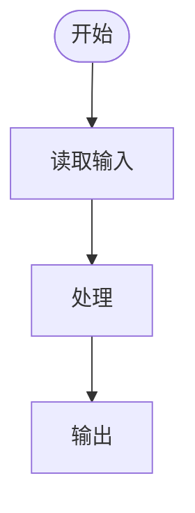

# PRD：$COMPONENT / $MODULE

> 模版：PRD-MOD.md ｜ 产出角色：product-manager ｜ 存放：docs/prd/$COMPONENT/$MODULE/prd.md（组件不细分模块时省略 $MODULE/）
> 前后台拆分时：`prd-ui.md`（前台，只约束 UI 行为）/ `prd-svc.md`（后台服务，约束业务规则与接口）

## 0. 文档定位

| 项 | 内容 |
|----|------|
| 组件 | `$COMPONENT`（snake_case） |
| 模块 | `$MODULE`（snake_case；组件不细分模块时 = `all`） |
| 前后台 | 前台（UI 行为）/ 后台服务（业务规则）/ 二者合一 |
| 需求状态 | `draft` 编写中 / `gated` 评审通过（占位符**已全部登记**，允许未清零）/ `closed` 占位符**已清零**、需求关闭 |
| L4 归属说明 | 按钮态、文案、动效、颜色、布局等**交互/视觉细节不入本文件功能需求**——见 `pages/prototype/$COMPONENT/` 与交互说明 |

### 0.1 范围与裁定

**范围裁定表**：本组件所有功能点的**范围前提**都编号固化在这里。功能点依赖某条裁定时，在 §3 的「关联裁定」行写上编号——需求变更时据此判断影响面，不必重读全文。

| 编号 | 裁定内容 | 来源 | 影响范围 |
|------|---------|------|---------|
| D-$COMPONENT-01 | （明确的范围决定，如"首版不提供自助注册，账号由初始化创建"） | （用户确认 / 评审结论 / 上游文档） | fr-xxx-001, fr-xxx-004 |

> 跨组件共享的裁定统一定义在 `docs/prd/overview.md`，本表只引用编号、不重复抄写正文。
> 裁定一旦生效，功能点不得与之矛盾；需推翻时走变更单（CR），不发散改 PRD。

**不包含表（明确不做）**：只写"不做"不够，必须写清**谁做**——否则范围会在下游悄悄蔓延回来。

| 不做项 | 说明 | 归属/去向 |
|--------|------|----------|
| （能力/范围项） | （为什么本期不做） | （归属组件 / 后续阶段 / 明确排除） |

## 1. 组件/模块概述

（组件职责、包含的业务、边界；模块职责）

**术语表**（本组件内出现、且跨组件容易歧义的名词；只收会被误读的词，不收通用技术词）

| 术语 | 定义 |
|------|------|
| | |

## 2. 业务-功能追溯矩阵

| 业务编号 | 业务名称 | 覆盖功能点 | 实现说明 |
|---------|---------|-----------|---------|
| biz-$COMPONENT-$MODULE-001 | | fr-$COMPONENT-$MODULE-001, ... | 由哪些功能、如何实现 |

## 3. 功能点详述

> 每个功能点复制以下小节。功能点必须可独立验收，**粒度经「五条检验」**（见 `prd` 技能）。

### fr-$COMPONENT-$MODULE-NNN （功能名称）

| 项 | 内容 |
|----|------|
| 优先级 | `M` 必须（首版不可缺）/ `S` 应该 / `C` 可以（预留） |
| 操作的用户 | |
| 输入 | |
| 输出 | |
| 处理逻辑 | 按**四问**写：①**判定条件**（哪些输入/状态走哪条分支，分支优先级与互斥）②**计算/转换规则**（公式、精度与取整、单位、排序/权重）③**状态迁移**（触发前 → 触发后；非法迁移写进 `negative` 条件）④**数据落点**（哪个实体 + 增删改查 + 幂等/去重口径）。**"调用接口后返回结果"不算写了逻辑**——合格标准：换个人照此实现，得到同一个结果 |
| 上游依赖 | `依赖<组件>提供<输入/约定>｜需要时机<何时>｜缺失时本组件<降级行为>`；纯单组件 FR 填 `—`。**只写依赖，不写对端内部算法/表结构/接口实现**（越界到设计阶段） |
| 约束条件 | |
| 关联业务 | biz-xxx |
| 关联裁定 | D-$COMPONENT-NN（依赖的范围前提，见 §0.1；无则填"—"） |
| 业务规则引用 | （前台 PRD 用 `【占位：待<服务名>PRD 补充·<规则名>】` 引用；后台 PRD 此处写规则本体或留空） |
| 粒度自检 | （确认：无「以及/同时还要」、无多个不相干 when、无 L4 交互细节） |

> **优先级口径**：`M/S/C` 是**需求优先级**（是否本期交付），与缺陷分级 P0/P1/P2 **无关**——不复用同一套字母，避免两套语义在报告里串味。只保留 M/S/C 三档，不设"禁止"档，"不做"写进约束条件或 §0.1 不包含表。

**验证标准**（条列 + GWT：每条一个可判定条件；key 只追加不重排不重用；kind ∈ normal/boundary/negative）

> 逐类对照生成清单（正常/边界/异常/权限校验/输入校验/状态约束），不适用的类别可省略但须说明理由。
> 自检技巧：**先写 GWT 再回填描述**——若多个 GWT 出现两种不相干的 `when`，即为拆分信号。

| key | Given（前置） | When（操作） | Then（可观察结果） | kind |
|-----|--------------|-------------|-------------------|------|
| c1 | 邮箱与密码均合法 | 提交注册 | 注册成功且落库 | normal |
| c2 | 邮箱长度=254（上限） | 提交注册 | 仍可注册 | boundary |
| c3 | 邮箱已被占用 | 提交注册 | 返回 409 且不落库 | negative |
| c4 | 未登录访客 | 调用管理接口 | 返回 403 拒绝 | negative |

**功能流程图**（判据：功能涉及 ≥2 次状态迁移或跨模块/跨组件调用时必填，其余可选）

---

## 4. 页面索引与界面要求（如涉及）

> 本表是**页面索引**（页面视角）；页面 ↔ FR 的完整对账在 `docs/prd/RTM.md` §2，两处不得各说各话。

| 页面编号 | 页面 | 目标 | 关键内容 | 主要操作 | 状态要求 | 关联功能点 |
|---------|------|------|---------|---------|---------|-----------|
| P1 | | | | | 空 / 加载 / 错误 / 无结果 / 无权限 | fr-$COMPONENT-$MODULE-001 |

> **状态要求**是必填项：每个页面至少写明确实存在的失败态与空态（如"加载骨架""检索无结果空态+清空入口""依赖不可达降级为空态"）。此列不允许留空或只写"正常"——异常态漏项是 PRD 最常见的缺陷来源。
> **主要操作**列与「页面 × FR 覆盖矩阵」口径一致：每个主要操作必须能挂到 ≥1 条功能点。

**关键交互约定**（只写跨页面统一规则，如二次确认、离开拦截、错误提示位置；**单个页面的按钮态/文案/样式属 L4，不入本文件**）

- 

## 5. 数据要求

（该模块涉及的业务实体，详见 dict.md）

| 实体 | 操作（增/删/改/查） | 关联功能点 |
|------|-------------------|-----------|
| | | |

## 6. 模块内约束

- 

## 7. 附录：异常清单与开放问题

### 7.1 异常清单

> 集中登记**跨功能点复用**或**易被漏测**的异常场景，并回指功能点；仅属单条 FR 的普通非法输入留在该 FR 的 `negative` 条件里，不在此重复。
> 测试侧据此出负向用例，不必从各 FR 反向挖掘。

| 编号 | 异常场景 | 处理方式 | 关联功能点 |
|------|---------|---------|-----------|
| EX-$COMPONENT-01 | | | fr-$COMPONENT-$MODULE-001 |

### 7.2 开放问题

> 未决项必须**有主、有落点**——不接受"待讨论"。未冻结前开发按问题条目里注明的假设推进，不阻塞。

| 编号 | 问题 | 当前假设（未冻结时按此推进） | 归属角色 | 计划回填位置 |
|------|------|---------------------------|---------|-------------|
| Q-$COMPONENT-01 | | | | 本文 §x / 某 PRD |

### 7.3 占位符回填清单

> 本文所有 `【占位：…】` 的登记处，回填后勾掉并同步更新 RTM。回填责任随对应服务 PRD 的产出转移。
>
> **两级完成态**：`gated` —— 正文每处占位都能在本表找到**同名登记**，且本表无幽灵行（允许未清零）；`closed` —— 正文占位清零，本表全部「已回填」。
> **机械校验**：`python scripts/verify_artifacts.py <项目根>` 的 `prd-status` 规则按占位符原文做**双向比对**——因此「占位内容」列**必须填占位符原文（含 `【占位：…】` 包裹）**，只写"某服务·某规则"会被判为未登记。
> **禁止永久占位**：明确不做的部分写进 §0.1 排除项，不得用占位符逃避关闭。

| 占位位置 | 占位内容（**填占位符原文**） | 当前假设（开发依此先做） | 回填责任 | 状态 |
|---------|--------------------------|----------------------|---------|------|
| §x | 【占位：待<服务名>PRD 补充·<规则名>】 | | | 待回填 / 已回填 |
