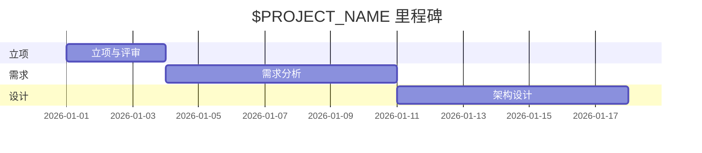

# 立项报告：$PROJECT_NAME

> 模版：PROJECT.md ｜ 产出角色：project-manager ｜ 存放：docs/PROJ_$PROJECT_NAME.md

## 1. 项目概述

| 项 | 内容 |
|----|------|
| 项目名称 | $PROJECT_NAME |
| 一句话定位 | （解决什么问题，一句话说清） |
| 版本 | v0.1 |
| 日期 | YYYY-MM-DD |

## 2. 项目背景与目标

- **背景**：（为什么做这个项目）
- **目标**：（可衡量的目标，含成功标准）

## 3. 目标用户与角色

| 角色 | 说明 | 核心诉求 |
|------|------|---------|
| | | |

## 4. 项目范围

### 4.1 范围内（做）
- 

### 4.2 范围外（明确不做）
- 

## 5. 核心业务

| 编号 | 业务名称 | 简述 |
|------|---------|------|
| biz-xxx | | |

## 6. 技术栈与依赖

| 类别 | 选型 | 理由 |
|------|------|------|
| 语言/框架 | | |
| 存储 | | |
| 依赖库 | | |

### 6.1 环境与工具链就绪核对

> 立项时**实测**（不是询问），缺项登记到 §9 风险，不得默认可用。

| 项 | 探测方式 | 结果 | 说明/缺口 |
|----|---------|------|----------|
| 版本控制 | `git --version` | | 架构师建骨架时需 `git init` + 初始 commit |
| 构建工具链 | 语言/打包器版本 | | |
| 包管理器与镜像源 | 安装一个依赖试跑 | | 含私有源凭证是否具备 |
| CI / 自动校验环境 | 能否运行 `scripts/verify.sh` | | 无 CI 时须说明本地校验方式 |
| 目标运行环境 | OS/容器/云规格 | | 与本地开发环境的差异 |

## 7. 项目约束

| 类别 | 约束 |
|------|------|
| 用户规模 | |
| 性能要求 | |
| 安全要求 | |
| 合规要求 | |
| 交付形态 | |
| 校验入口 | `scripts/verify.sh`（架构师搭骨架时初始化；`--fast`：格式/lint/类型/单测；全量：+构建/集成/扫描） |
| 周期/里程碑 | |

## 8. 里程碑

## 9. 风险

| 编号 | 风险 | 影响 | 概率 | 应对 |
|------|------|------|------|------|
| R-01 | | | | |

## 10. 待确认项

| 编号 | 待确认内容 | 影响 | 状态 |
|------|-----------|------|------|
| Q-01 | | | 待用户确认 |

---

## 评审记录

| 评审人 | 结论 | 日期 | 备注 |
|--------|------|------|------|
| 用户 | | | |
| project-reviewer | | | |
